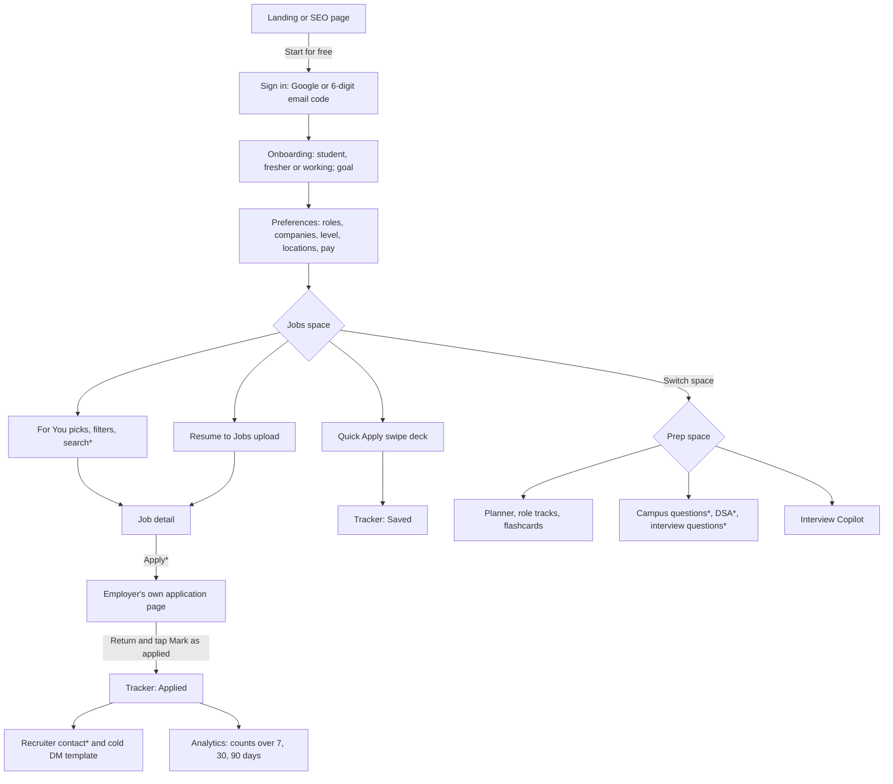
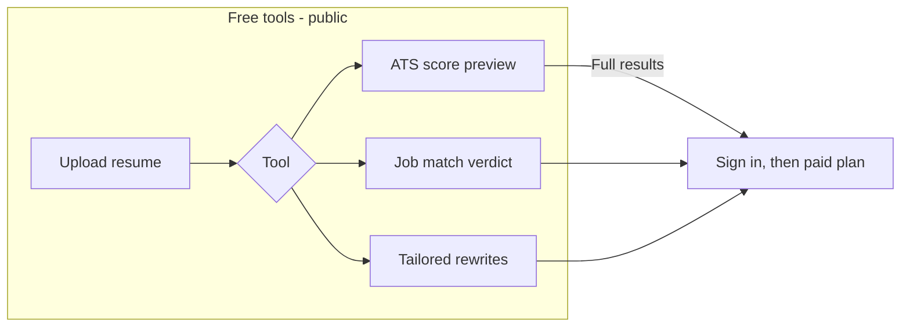

# 1. Product reconnaissance: Astra (useastra.in)

**Date of observation:** 10 November 2026. **Scope:** public, unauthenticated pages only.

## Method and limits

- Read `robots.txt`, `sitemap.xml`, `llms.txt`, and the Markdown alternates the site publishes for machine readers (`/.md`, `/guide.md`, `/jobs.md`, `/compare/astra-vs-naukri.md`, `/campus/tcs.md`).
- Rendered 25 public pages in headless Chromium at 1440 px and 390 px; captured headings, controls, requested hosts and an axe-core WCAG 2 A/AA scan for each.
- Downloaded the 28 JS/CSS files referenced by the home page and searched them for library fingerprints.
- **Not done:** no sign-in, no account creation, no payment, no calls to private APIs, nothing under paths that `robots.txt` disallows (`/api/`, `/auth/`, `/settings/`, `/onboarding/`), no form submissions, no file uploads. Recruiter names and email addresses visible on public pages were not recorded.
- **Consequence:** everything behind the login (dashboard, tracker, AI chat, prep planner, Talent) is known only from Astra's own public guide, and is classified accordingly.
- The sandbox blocked third-party hosts, so analytics scripts and the auth subdomain never loaded. Two in-app-shell pages showed error states that may be artefacts of that block; they are marked Unverified.

**Evidence classes used throughout**

| Class | Meaning |
| --- | --- |
| **Observed** | Seen directly on a public page or in a public file |
| **Inferred** | Follows from observed evidence, not seen directly |
| **Hypothetical** | Plausible, with no direct evidence |
| **Unverified** | Astra states it; it could not be checked from outside |

## Information architecture

**Observed.** The sitemap lists 8,417 URLs.

| Section | URLs | Purpose |
| --- | --- | --- |
| `/jobs/*` | 7,305 | Job detail pages plus programmatic landing pages by city, category, experience, company, work-from-home |
| `/internships/*` | 722 | Internship detail pages |
| `/campus/*` | 138 | Company recruitment guides and past questions (aptitude, DSA, core CS, interview) |
| `/salaries/*` | 68 | Pay pages by function and city |
| `/recruiters/*` | 52 | Per-company recruiter contact pages |
| `/resume-templates/*` | 18 | Role-specific resume examples |
| `/compare/*`, `/alternatives/*`, `/best/*` | 35 | Competitor comparison SEO pages |
| `/interview-questions/*`, `/aptitude-questions/*`, `/dsa/*` | 19 | Question banks |
| `/free-tools/*` | 7 | Resume builder, cover letter builder, ATS checker, keyword analysis, job match check, resume tailor, LinkedIn optimizer |
| Singles | ~50 | Pricing, guide, app waitlist, portfolio builder and templates, analysers (resume, GitHub, portfolio), affiliate, legal |

Two public navigation shells exist: a marketing header (Explore, Portfolio, Pricing, API, Community, Candidates/Employers switch) and a board header (Jobs, Internships, Recruiters, Off-campus, Salaries, Map). The signed-in app has a sidebar split into two spaces, **Jobs** and **Prep** (observed on `/interview-copilot`, which renders the app sidebar publicly). Sub-brands: `talent.useastra.in` (employer side) and `datasets.useastra.in` (a jobs data API).

## Feature inventory

| # | Feature | What it does | Gate | Class |
| --- | --- | --- | --- | --- |
| 1 | Jobs board | Grid, table and compact views; ~24 cards per page; breadcrumbed detail pages | Browse free | Observed |
| 2 | Job search box | Text search over company and role | Paid: the control's accessible name is "Upgrade to search job opportunities" | Observed |
| 3 | Filters | Category, location, experience, salary, remote | Unknown whether gated | Observed (control), Unverified (behaviour) |
| 4 | Apply | Link out to the employer's own page | "Applying needs a paid plan; free accounts can browse and save" | Observed in the public guide |
| 5 | "Verified" badge | "Verified direct application link, checked by Astra" | Free | Observed; no date shown on the job page |
| 6 | Salary on listings | A range in LPA on almost every card | Free | Observed; see teardown on labelling |
| 7 | Internships board | Same pattern as jobs | Browse free | Observed |
| 8 | Off-campus calendar | Fresher roles by day, with function filters | Free | Observed |
| 9 | Salaries pages | Median and range by function, city and level, "from roles open today" | Free | Observed |
| 10 | Company and map views | Who is hiring, by company and by location | Sign-in | Unverified |
| 11 | Resume to Jobs | Upload a resume, get ranked live roles with a per-criterion breakdown | Page says "Free, no signup needed"; clicking upload opens "Log in to find jobs with your resume" | Observed (both the claim and the gate) |
| 12 | Resume audit / ATS checker | Score out of 100 across ATS compatibility, structure, content, grammar, keyword match, with a fix per issue | Free preview; full results paid | Observed (copy), Unverified (output) |
| 13 | Job match check | Paste a job description and upload a resume for an apply / stretch / skip verdict | Free tool | Observed (form) |
| 14 | Resume tailor, keyword analysis, cover letter, LinkedIn optimizer | Rewrites and analysis against a job | AI parts paid | Observed (forms) |
| 15 | Resume builder | Templates, PDF and Word export | 2 resumes free, 20 a month paid | Observed in pricing |
| 16 | Portfolio builder | Hosted page at `/p/your-name`, 6 templates | 1 template with badge free | Observed in pricing |
| 17 | GitHub and portfolio analysers | Extract skills, match roles | Sign-in | Unverified |
| 18 | Quick Apply | Swipe deck: right saves to tracker, left skips, undo | 6 swipes free | Observed (marketing page) |
| 19 | Tracker | List and board: Saved, Applied, Screening, Interview, Offer, Rejected; pin; "Mark as applied" | Saving and tracking free | Unverified (guide) |
| 20 | Analytics | Applied and saved counts over 7, 30, 90 days | Sign-in | Unverified (guide) |
| 21 | Recruiter contacts | Named recruiters with email, "verified N months ago", reveal and copy | Some shown publicly as "FREE"; "Premium unlocks every contact" (149 contacts at 103 companies per pricing; 324 contacts at 140 companies per `/hr-list`) | Observed |
| 22 | Cold DM and email templates | 109 templates; drafts that "send from your own inbox" | Browse free, search paid | Observed in pricing |
| 23 | Interview Copilot | Configure role, type (technical, behavioural, system design, mixed), 3 to 15 questions, 15 to 60 minutes; variants for DSA, remote, phone | Sign-in to run | Observed (setup form), Unverified (session) |
| 24 | Prep space | Home, planner, review, role tracks, flashcards, mock tests, HR notes | Sign-in | Unverified (sidebar labels observed) |
| 25 | Question banks | 873 interview questions, 701 DSA problems, aptitude; campus questions from 28 companies | Lists free, answers paid | Observed |
| 26 | Campus guides | Eligibility, test pattern, rounds per company | Free | Observed |
| 27 | Astra AI chat, Autofill extension | Chat that knows the jobs; form-filling extension that never submits | Paid; 50 AI credits a month | Unverified (guide) |
| 28 | Astra Talent | Reverse marketplace: anonymous profiles, "Astra Score", employer requests | Paid, early access | Unverified (guide) |
| 29 | Job Sprint | "Top 20 matched roles and a 60-day plan" | 6-month, lifetime and squad plans | Observed in pricing |
| 30 | Mobile app | iOS and Android | Waitlist, while store badges are displayed | Observed |
| 31 | Affiliate programme, datasets API, employer side | Growth and B2B surfaces | n/a | Observed (links) |

## Onboarding and core journeys

**Unverified, from the public guide**, except where marked.

`*` = paid, or partly paid. **Observed:** the login page offers Google and an email code, shows a testimonial, and a live counter ("337 new jobs and internships added in the last 24 hours").

The second diagram is **Inferred** from pricing ("ATS check and resume tailoring: Preview / Full results") and from the login modal on Resume to Jobs.

## Search, filters and recommendations

- **Observed:** job search is a paid control. Category, city and level browsing is free through crawlable landing pages.
- **Observed:** list cards show title, company with a tick, pay band, level, location, work mode, function and "Posted N days ago".
- **Unverified:** "For You" picks are built from stated preferences, not from the resume ("Why are my For You picks not relevant? They come from your preferences").
- **Inferred:** Resume to Jobs is a separate, on-demand ranking over "live jobs from the last 30 days", not the default feed.
- **Hypothetical:** ranking is recency-first with preference filters. Nothing public explains why a job is ranked where it is.

## Resume analysis and matching

- **Observed (copy):** a five-part rubric and "a specific fix for every flagged line"; a job-match verdict of apply, stretch or skip with strengths and gaps.
- **Unverified:** output quality, whether feedback cites the resume, whether skills are ever inferred beyond the text.

## Interview preparation

- **Observed:** the Copilot setup is role, type, question count and duration. It is not tied to a specific job listing or to the user's resume.
- **Observed:** public question pages give a model answer, points to hit, mistakes and follow-ups.
- **Unverified:** adaptivity, feedback format, scoring.

## Application tracking

- **Unverified:** six stages, pinning, and a manual "Mark as applied" step on return. The guide calls that tap "what keeps your Tracker accurate".
- **Observed by omission:** no public mention of follow-up reminders or dated next actions. Analytics are described as counts only.

## Pricing and paywalls (Observed)

| Plan | Price shown | Notes |
| --- | --- | --- |
| Free | ₹0 | Browse, save, track; 6 Quick Apply swipes; 2 resumes; 5 AI credits; no applies, no search |
| 1 month | ₹499 (struck from ₹1,199) | "No job guarantee" |
| 6 months | ₹699 (from ₹1,999), "₹117 a month" | 60-day job guarantee, Job Sprint |
| Lifetime | ₹899 (from ₹2,999), "Best value" | Pay once; guarantee; 50 AI credits a month |
| Squad | ₹2,499 for 4 lifetime seats | |

Payment by UPI or card; "Nothing renews automatically". Refund policy: none, except the 60-day guarantee, claimed by email after 60 days by confirming no offer was received. The home hero says "land your dream job in 30 days"; the guarantee window is 60.

## Responsive behaviour (Observed at 390 px)

- No horizontal scrolling on 24 of 25 pages; `/app` overflows by 20 px.
- Board pages have 60 to 70 links or buttons smaller than 24 × 24 CSS px (mostly footer link lists).
- A sticky "Unlock every role" bar covers the bottom of job pages.
- Job detail stacks cleanly; the header collapses to a menu button.

## Accessibility and UX weaknesses (Observed)

| Finding | Evidence |
| --- | --- |
| Colour contrast failures on most pages | axe `color-contrast` (serious): 18 nodes on home, 12 on jobs, 16 on job detail, 113 on `/recruiters`, 84 on a question page, 63 on the calendar |
| Icon-only controls depend on `aria-label` | Present and correct on those checked (theme toggle, share, copy) |
| Images have alt text | 0 of 46 images on home lacked `alt` |
| Key claims disagree across pages | Open-role counts: 15,635 "India jobs" on the board tab, 4,145 in `/jobs.md`, "2,800+" on pricing. Recruiter contacts: 149 on pricing, 324 on `/hr-list` |
| Claim and gate disagree | Board hero: "no login wall"; page footer bar: "Log in free"; guide: applying needs a paid plan. Resume to Jobs: "no signup needed", then a login modal |
| Pay is shown without a source label on the job page | Detail page shows "₹10–17 LPA"; only the meta description says "Estimated pay"; `/jobs.md` promises figures "labelled as either employer-stated or Astra-estimated" |
| Many cards share one pay band | 6 of the first 8 cards on `/jobs` showed "₹6–11 LPA" |
| Listing contradictions pass through | A sampled role is labelled "Fresher · 1+ years" while its text asks for "6+ months" |
| Descriptions are summaries | The sampled detail page had a one-sentence description, against the claim of "the full job description" |
| Unsourced social proof | "Rated 4.9 out of 5" with no source or count |
| Named individuals' work emails are public | `/recruiters` shows names and addresses, some marked "FREE" |
| Store badges for an unreleased app | `/app` shows App Store and Google Play buttons above a waitlist form |
| Error states | `/companies`: "Error loading companies"; `/knowledge-base`: "Error" (**Unverified:** may be caused by this sandbox blocking the auth host) |
