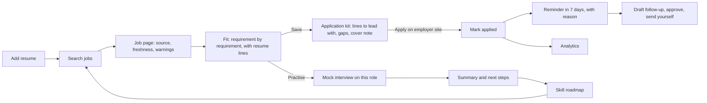
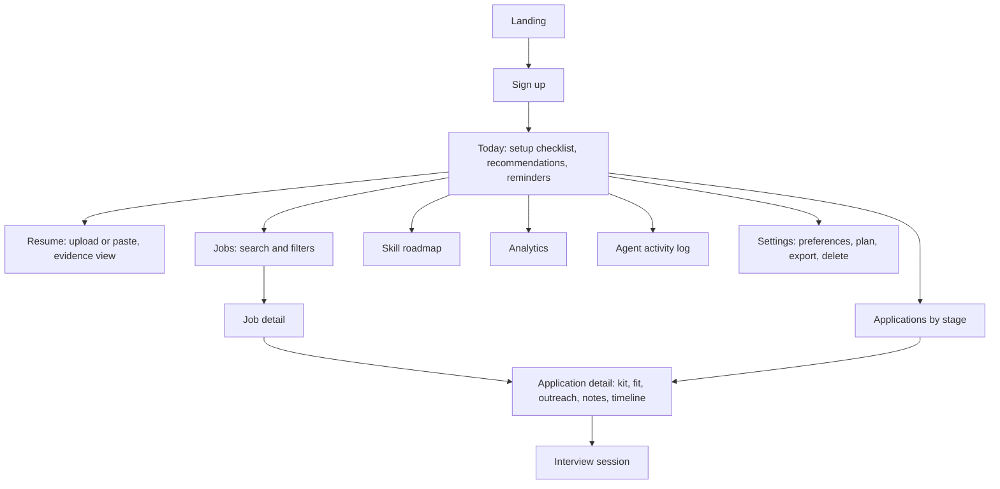

# 4. Product requirements: Evident

## Problem

Early-career job seekers apply widely and learn little. Job boards tell them a role exists, not whether their resume supports it. AI tools give scores without reasons, estimate pay without saying so, and sometimes add experience the candidate does not have. The result is wasted applications, misplaced confidence and, occasionally, a resume that will not survive an interview.

## Product principle

**Every claim the product makes carries its evidence, and where there is no evidence the product says so.** This applies to listings (source, age, last verification), fit (the resume line behind each credited requirement), pay (employer-stated or absent), AI output (checked against source text, with fallback), and analytics (no rate without a sample).

## Who it is for

Personas are hypotheses drawn from the reference product's audience and its public guide. **No user interviews were conducted.** Validating them is the first item in the launch plan.

| Persona | Situation | Job to be done | Current workaround |
| --- | --- | --- | --- |
| **Final-year student** | One or two internships, several projects, campus placements under way | "Tell me which of these roles I can actually get, and what to fix before I apply" | Applies to everything; asks seniors |
| **Recent graduate, off-campus** | No placement cell; 3 to 9 months of searching | "Keep my search organised and tell me when to follow up, so nothing goes cold" | Spreadsheet, memory |
| **Early-career switcher** | 1 to 3 years in one role, wants an adjacent one | "Show me the gap between what I have done and what the new role wants, and how to close it" | Courses chosen by guesswork |

## Goals and non-goals

**Goals**

1. A user can go from a search to a submitted application, a scheduled follow-up and a practised interview for one role without leaving the product or re-entering data.
2. Every fit assessment is reproducible and inspectable.
3. The product is fully usable with no AI model configured.

**Non-goals for this release**

- Hosting applications or applying on the user's behalf.
- A recruiter contact database. Evident does not look up people.
- Pay estimates.
- Resume and portfolio builders, a mobile app, an employer side.
- India-specific placement content (campus test patterns, aptitude banks).

## Requirements and status

| # | Capability | Requirement | Status | Where |
| --- | --- | --- | --- | --- |
| 1 | Personalised job discovery | Full-text search with level, work mode, location and freshness filters; ranking blends query relevance, evidence fit, freshness and stated preferences; each result says why it is ranked there | Built | `services/jobs.ts`, `/app/jobs` |
| 2 | Verified sources and freshness | Listings only from configured public job-board APIs; source, age (posted or first-seen, labelled), last verification time; closed listings marked; reposts linked and hidden; integrity warnings | Built | `agents/discovery.ts`, `jobs/freshness.ts`, `jobs/dedupe.ts` |
| 3 | Resume-to-job evidence matching | Requirement-by-requirement status (demonstrated, listed only, related, missing, cannot verify), each with the listing quote and the resume line; verdict with confidence and cautions | Built | `match/score.ts`, `components/match-view.tsx` |
| 4 | Tracking and follow-up reminders | Seven stages; timeline; reminders created by rule with a stated reason; idempotent | Built | `services/applications.ts`, `agents/followup.ts` |
| 5 | Recruiter outreach assistance | Drafts from known facts with visible placeholders for unknowns; explicit approval before a draft can be marked sent; nothing is sent by the platform | Built | `agents/followup.ts`, application page |
| 6 | Adaptive AI mock interviews | Questions drawn from the listing's requirements and the user's resume (deep-dives, gap probes, concepts, behavioural); difficulty adapts per answer; feedback quotes the answer | Built (text only) | `agents/interview.ts`, `interview/*` |
| 7 | Skill-gap analysis | Gaps aggregated across the user's target roles with demand counts and listing quotes | Built | `services/roadmap.ts` |
| 8 | Preparation roadmaps | Week-by-week plan per gap, each ending in a piece of evidence to add to the resume | Built (templated by skill category) | `services/roadmap.ts` |
| 9 | Career analytics | Funnel, response and interview rates, time to response, weekly volume, by-fit comparison; rates withheld under five applications; comparisons labelled tentative | Built | `agents/analytics.ts` |
| 10 | AI career agent that explains itself | Prioritised next actions with the facts behind each and a statement of uncertainty; a full log of agent runs and tool calls | Built | `agents/strategy.ts`, `/app`, `/app/activity` |

**Mock or partial, labelled in the product**

| Item | State |
| --- | --- |
| Demo job board | Synthetic listings for fictional companies, badged "Demo data" everywhere |
| Billing | Plan switch in Settings changes allowances; no payment is taken; labelled "Demonstration billing" |
| OAuth sign-in | Implemented for Google and GitHub; appears only when credentials are configured; **not exercised against live providers** |
| Model-written feedback and drafts | Implemented behind a provider interface; **tested only with a scripted provider** |
| Voice interviews, email delivery of reminders, calendar sync | Not built |

## Core journey

## Screen flows

## Acceptance criteria for the core journey

Each is asserted by `tests/e2e/journey.spec.ts` in a real browser.

1. Search returns the relevant role first, with a fit badge, a freshness badge and a "Demo data" badge; the repost is not shown.
2. The job page quotes specific resume lines against specific requirements, marks at least one requirement missing, and offers a free apply link to the source's own domain.
3. Saving creates an application; building the kit yields lead lines and a cover note that names the role and employer and adds nothing absent from the resume.
4. Marking applied creates a follow-up reminder with its reason.
5. An outreach draft cannot be marked sent before it is approved.
6. A five-question interview completes, scores a non-answer as such, quotes a strong answer back, and ends in a summary.
7. Another signed-in user gets a 404 for the first user's application.
8. No page has a WCAG 2.1 A or AA violation detectable by axe, or horizontal scroll at 390 px.

## Success metrics

See `10-strategy.md` for the North Star and supporting metrics.

## Open questions

1. Do students want a verdict ("weak fit"), or does it discourage applications they should make? Needs interviews and an experiment.
2. Is a text mock interview enough, or is voice the minimum bar?
3. Which Indian employers publish on the supported job-board APIs? Coverage decides whether the "verified sources only" stance is viable in this market.
