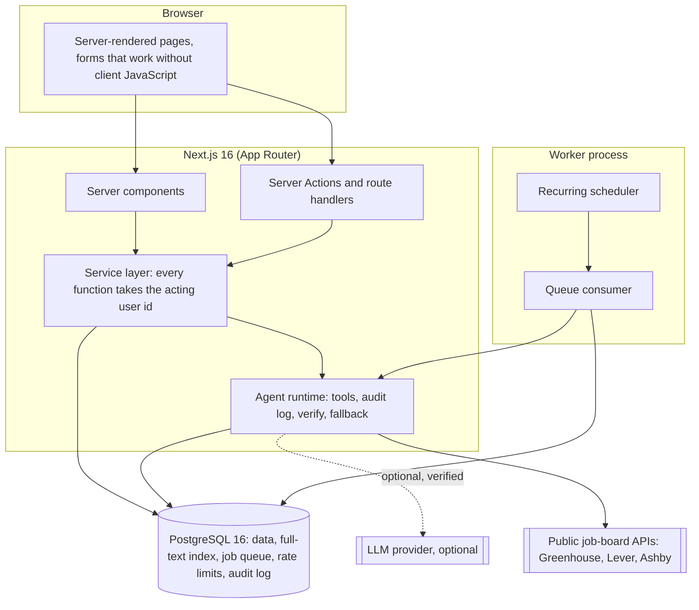
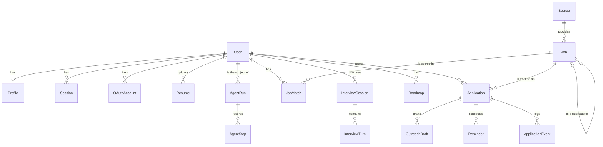
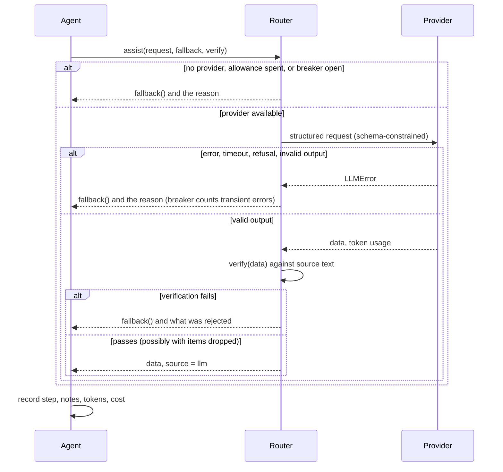

# 5. System architecture and database schema

## Overview

One database is the only required dependency. The web process and the worker are the same codebase.

## Layers

| Layer | Path | Rule |
| --- | --- | --- |
| Domain logic | `src/lib/{resume,jobs,match,interview}` and `taxonomy.ts` | Pure functions. No I/O, no clock unless passed in. Unit-tested |
| Agents | `src/lib/agents` | Act only through declared tools with schema-validated input; every run and step is recorded |
| LLM | `src/lib/llm` | One interface, three providers, one router with verification, fallback and a circuit breaker |
| Services | `src/lib/services` | All database access for user data, always scoped by `userId` |
| Auth | `src/lib/auth` | Password hashing, sessions, rate limits, OAuth |
| Delivery | `src/app` | Pages, Server Actions, four route handlers |
| Background | `src/worker`, `src/lib/queue.ts` | Scheduler and consumer |

## Data model

Stand-alone tables: `BackgroundJob` (queue) and `RateLimit` (fixed windows).

| Table | Key fields | Notes |
| --- | --- | --- |
| `User` | `email` unique, `passwordHash` nullable, `plan` | Deleting a user cascades to everything they own |
| `Session` | `id` = SHA-256 of the cookie token, `expiresAt` | The raw token is never stored |
| `Resume` | `rawText`, `parsed` (sections, lines, skills with evidence), `status`, `warnings` | A failed parse never becomes the active resume |
| `Source` | `(kind, slug)` unique, `isSynthetic`, `lastSyncStatus` | |
| `Job` | `(sourceId, externalId)` unique; `requirements` JSON; `salaryStatus`; `postedAt`, `firstSeenAt`, `lastSeenAt`, `lastVerifiedAt`, `verifyStatus`; `status`, `closedReason`; `dedupeKey`, `duplicateOfId`; `integrityFlags`; `searchVector` | `searchVector` is a stored generated `tsvector` (title A, company and location B, description C) with a GIN index |
| `JobMatch` | `(userId, jobId, resumeId)` unique; `score`, `verdict`, `confidence`, `breakdown` | Stored when a user views or saves a job; used by analytics |
| `Application` | `(userId, jobId)` unique; `status`; `appliedAt`; `kit` JSON | |
| `Reminder` | `dedupeKey` unique | Makes reminder planning idempotent |
| `OutreachDraft` | `status` (draft, approved, sent_by_user, discarded); `grounding` JSON; `approvedAt` | |
| `InterviewSession`, `InterviewTurn` | `plan` (pool, asked ids, difficulty), `summary`; per turn: `question`, `answer`, `evaluation` | |
| `AgentRun`, `AgentStep` | agent, trigger, status, provider, model, tokens, cost, latency, notes; per step: tool, input, output, status | Inputs and outputs are truncated summaries; raw resume text and secrets are excluded |
| `BackgroundJob` | `status`, `attempts`, `runAt`, `lockedAt`, `idempotencyKey` unique | Partial index on queued rows |

The schema is `prisma/schema.prisma`; the migration is `prisma/migrations/0001_init/migration.sql`.

## Search and ranking

1. **Retrieve:** `websearch_to_tsquery` against the generated vector, plus filters, excluding closed listings and duplicates; up to 300 candidates ordered by `ts_rank_cd`.
2. **Score in memory:** for each candidate, compute freshness and, if the user has a resume, the evidence match (a pure function over stored JSON; no query per listing).
3. **Blend:** with a query, 0.40 text + 0.30 fit + 0.15 freshness; without, 0.55 fit + 0.25 freshness; plus small boosts for a target-role title match and a preferred location; × 0.6 for a serious integrity flag.
4. **Explain:** the same function returns the reasons shown under "Why it is here".

**Upgrade path.** The retrieval step is one SQL statement behind `searchJobs`. Past a few hundred thousand open listings, or when typo tolerance and facets are needed, replace step 1 with a search engine (Typesense, Meilisearch or OpenSearch) fed from the same `Job` rows; steps 2 to 4 are unchanged. Semantic retrieval (pgvector) fits the same seam.

## Background processing

`BackgroundJob` is a durable queue: `enqueue` is idempotent on a unique key; `claim` is a single `UPDATE … WHERE id = (SELECT … FOR UPDATE SKIP LOCKED LIMIT 1)`; a job is acknowledged only after its handler returns; a lock older than five minutes is reclaimed; failures back off exponentially (15 s doubling, capped at an hour) and park as `dead` after `maxAttempts`. Delivery is at-least-once, so handlers are idempotent.

Recurring work is enqueued with time-bucket keys, so any number of workers can run the scheduler: source sync every 6 hours per source, apply-link verification hourly, follow-up planning every 12 hours per user.

## AI pipeline

A model is used in four places only: implied resume skills, cover-note wording, outreach wording, interview feedback. Requirement extraction, matching, ranking, reminders, strategy, analytics and scoring are deterministic.

**Untrusted text.** Job descriptions are never sent to a model. Resume text and interview answers are, wrapped in an `<untrusted>` block whose closing tag is stripped from the content, under a system prompt that says to ignore instructions inside it. Whatever comes back is still checked against the source.

## Security model

| Threat | Control | Test |
| --- | --- | --- |
| Reading or changing another user's data | No query on user-owned tables without `userId` in the `where`; a foreign id behaves as "not found" | Integration: 10 cross-user calls rejected; e2e: 404 |
| Session theft from a database leak | Only a hash of the token is stored | Integration |
| Password attacks | scrypt (N = 32768), constant-time compare, a dummy hash for unknown emails, rate limits per IP and per email | Integration |
| CSRF | Server Actions (Next.js checks `Origin`); `SameSite=Lax`, `HttpOnly`, `Secure` cookies; return paths restricted to `/app/...` | Code review |
| XSS | React escaping; job descriptions rendered as text, never HTML; CSP `default-src 'self'`, `frame-ancestors 'none'` | Header check on the built server |
| SQL injection | Parameterised queries throughout, including raw SQL | Integration with hostile strings |
| Prompt injection via listings | Hidden text dropped; AI-directed sentences flagged and removed; listing text never reaches a model | Unit, integration, e2e |
| Hallucinated content | Verbatim-quote and no-new-facts checks; rubric bounds on scores | Integration, evals |
| Account takeover via OAuth | An existing account is linked only on a provider-verified email; state checked in constant time; PKCE for Google | Integration (linking logic only) |
| Abuse of expensive paths | Rate limits on sign-up, sign-in, resume upload, interviews, public API; 3 MB upload cap | Integration (limiter) |
| Malicious apply links | Only `http(s)` URLs are stored; others drop the listing; links open with `rel="noopener noreferrer"` | Integration, e2e |

**Known gaps.** No email verification on password sign-up. No multi-factor authentication. No audit of administrative actions (there is no admin surface). The CSP allows inline scripts, which Next.js needs without nonces. Rate limits key on `x-forwarded-for`, which is only trustworthy behind a proxy that sets it.

## Observability

- `/api/health`: database round-trip, queue depth, dead jobs, model configured, breaker state.
- `AgentRun` and `AgentStep` are the application-level trace: status, latency, tokens and cost per run, queryable by agent and by user.
- `Source.lastSyncStatus` and `lastSyncError` per source.
- Not built: metrics export, error tracking, product analytics. `09-deployment.md` lists what to add.

## Decision log

| # | Decision | Alternatives | Why |
| --- | --- | --- | --- |
| 1 | Deterministic engine first, model optional | Model-first with guardrails | The product's promise is checkable evidence. Rules give reproducible results, zero marginal cost, and a product that works during a model outage. The cost is recall: skills phrased unusually are missed |
| 2 | Queue in PostgreSQL, not Redis | BullMQ on Redis (the suggested stack) | One dependency to deploy and back up; transactional enqueue with business data; adequate at this scale. Revisit at sustained hundreds of jobs per second, or if delayed-job precision matters |
| 3 | Next.js Server Actions and a service layer, not a separate FastAPI service | FastAPI and a typed client | One language and one deploy; the domain logic is plain TypeScript and could move behind an HTTP API without change |
| 4 | Own session auth with scrypt and `arctic` for OAuth | Auth.js; a hosted identity provider | A few hundred lines, fully testable, no beta dependency. A hosted provider is the better choice once email verification, MFA and account recovery are needed |
| 5 | Prisma 6 with raw SQL for search and the queue | Drizzle; Prisma 7 | Schema-first migrations and typed queries; raw SQL where Prisma has no expression (`tsvector`, `SKIP LOCKED`) |
| 6 | Job-board APIs only; no crawling | Scrape career pages | Permitted, stable, structured. The cost is coverage, which is the main open product risk |
| 7 | No pay estimates | Banded estimates labelled as such | A wrong estimate shown next to a real listing damages the one thing the product sells |
| 8 | No recruiter contact data | Buy or collect contacts | Privacy risk and unverifiable freshness; drafts with a user-supplied recipient deliver most of the value |
| 9 | Tests never wipe the database | Truncate between tests | Unique ids per run isolate tests, and the suite can run against any database safely |
| 10 | System fonts | A hosted or bundled typeface | No external requests, no layout shift, a strict CSP; the display serif stack gives enough character |
