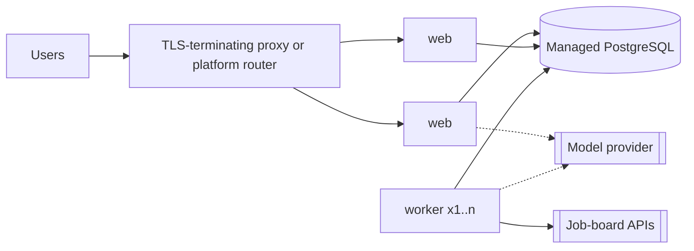

# 9. Deployment

## Status

**Evident has not been deployed to a public host.** This environment had no hosting credentials, and creating paid cloud resources on someone's account needs their go-ahead. What was verified here:

| Verified in this environment | Result |
| --- | --- |
| Production build (`next build`) | Succeeds; 22 routes |
| Production server (`next start`) on PostgreSQL 16 | Serves the full end-to-end suite |
| Self-contained build (`BUILD_STANDALONE=true`, the form the Docker image runs) | Boots; `/api/health` returns `ok`; security headers present |
| Worker and job sync against the database | Runs; demo board synced |
| Live connector calls to Greenhouse, Lever and Ashby public APIs | Succeeded (see the evaluation report) |

| Not verified | Why |
| --- | --- |
| `docker build` and `docker compose up` | No Docker daemon in this environment. The Dockerfile and compose file are untested |
| The GitHub Actions workflow | Not run; no pull request was opened |
| Any managed host | No credentials |
| OAuth against Google or GitHub | No client credentials |
| A live model provider | No API key |

## Requirements

- Node.js 22 or later
- PostgreSQL 14 or later (16 tested)
- Nothing else. No Redis, no object storage, no search engine.

## Environment configuration

Copy `.env.example` to `.env`.

| Variable | Required | Default | Purpose |
| --- | --- | --- | --- |
| `DATABASE_URL` | Yes | | PostgreSQL connection string |
| `APP_URL` | Yes | `http://localhost:3000` | Public origin. Used for OAuth redirects and origin checks. Must be `https://…` in production |
| `LLM_PROVIDER` | No | `none` | `none`, `anthropic` or `openai-compatible` |
| `ANTHROPIC_API_KEY` | If `anthropic` | | When unset, the SDK resolves credentials from its environment |
| `ANTHROPIC_MODEL` | No | `claude-opus-5-5` | Model id |
| `OPENAI_COMPATIBLE_BASE_URL`, `_API_KEY`, `_MODEL` | If `openai-compatible` | | Any endpoint that implements `/chat/completions` with JSON-schema output |
| `AI_RUNS_FREE`, `AI_RUNS_PLUS` | No | `30`, `300` | Monthly model-backed agent runs per user, by plan |
| `GOOGLE_CLIENT_ID`, `GOOGLE_CLIENT_SECRET` | No | | Enables "Continue with Google". Redirect URI: `${APP_URL}/api/auth/google/callback` |
| `GITHUB_CLIENT_ID`, `GITHUB_CLIENT_SECRET` | No | | Enables "Continue with GitHub". Callback: `${APP_URL}/api/auth/github/callback` |
| `JOB_SOURCES` | No | empty | Comma-separated `kind:board-token[:Display Name]`; kinds `greenhouse`, `lever`, `ashby` |
| `ENABLE_DEMO_SOURCE` | No | `true` | Loads the synthetic demo board. Set to `false` in production |
| `BUILD_STANDALONE` | Build-time | unset | `true` produces the self-contained server the Docker image uses |
| `TEST_DATABASE_URL`, `E2E_DATABASE_URL` | Tests | local defaults | Databases for the integration and end-to-end suites |

Secrets belong in the host's secret store, not in the repository. `.env` is git-ignored.

### Choosing job sources

Add only boards whose terms allow it. Each entry is the public board token an employer uses on its careers page.

```bash
JOB_SOURCES="greenhouse:exampleco:Example Co,lever:anotherco,ashby:thirdco"
```

Invalid entries are reported at worker start and skipped.

## Run locally

```bash
cd evident
```

```bash
npm ci
```

```bash
cp .env.example .env
```

Create a database and point `DATABASE_URL` at it, then:

```bash
npm run db:migrate
```

```bash
npm run sync
```

```bash
npm run dev
```

In a second terminal, for scheduled syncs, link checks and reminders:

```bash
npm run worker
```

## Run with Docker Compose (untested, see Status)

```bash
docker compose up --build
```

This starts PostgreSQL, applies migrations, then starts the web server on port 3000 and one worker. Set `POSTGRES_PASSWORD`, `APP_URL`, and any optional variables in the shell or a `.env` file beside `docker-compose.yml`.

## Production topology



- **Web** is stateless; scale horizontally. Sessions and rate limits live in PostgreSQL.
- **Worker**: one is enough to start. Several can run safely; the queue hands each job to one worker and the scheduler is idempotent.
- **Database**: any managed PostgreSQL. Use a pooled connection string for the web tier if the host limits connections.
- **Proxy**: must set `x-forwarded-for` and `x-forwarded-host`. Rate limits and origin checks rely on them.

Fits without change: a container platform (Fly.io, Render, Railway, Cloud Run, ECS) running the `web` and `worker` image targets. On a serverless host (Vercel), deploy the web app as is and run the worker elsewhere, or call `scheduleRecurring` and `drain` from a scheduled function.

### Release steps

1. Build the image.
2. Run `npx prisma migrate deploy` once against the production database (the compose file's `migrate` service does this).
3. Roll out `web`, then `worker`.
4. Check `/api/health`.

Migrations are forward-only SQL in `prisma/migrations`. Never run `prisma migrate reset` against a database that holds data.

## Operations

| Signal | Where | Act when |
| --- | --- | --- |
| Liveness and database | `GET /api/health` returns 200 `{"status":"ok"}`, 503 if the database is unreachable | Any 503 |
| Queue backlog | `queue.queued` in `/api/health` | Grows across checks: add workers |
| Dead jobs | `queue.dead` in `/api/health`; rows in `BackgroundJob` with `status = 'dead'` and `lastError` | Above zero: read `lastError`, fix, set the row back to `queued` |
| Source health | `Source.lastSyncStatus`, `lastSyncError` | `failed`, or `degraded` twice running |
| Model health | `llm.breaker` in `/api/health`; `AgentRun.status = 'degraded'` with notes | Breaker stays open: the provider or key is failing. Users are unaffected beyond wording quality |
| Agent errors | `AgentRun.status = 'failed'` | Any |

**To add before real traffic:** error tracking, log shipping, metrics and alerts on the signals above, database backups with a tested restore, email verification and password reset, a privacy policy and terms, and a data-retention job for old `AgentRun`, `RateLimit` and finished `BackgroundJob` rows (none exists yet, so these tables grow without bound).

## Security checklist for production

- `APP_URL` is `https://`; cookies are then `Secure`.
- `ENABLE_DEMO_SOURCE=false`.
- The database is not publicly reachable; the application role is not a superuser.
- The proxy overwrites, not appends to, `x-forwarded-for`.
- Model and OAuth secrets are in the secret store and rotated.
- Uploads are capped at 3 MB in the app; set the same limit at the proxy.
